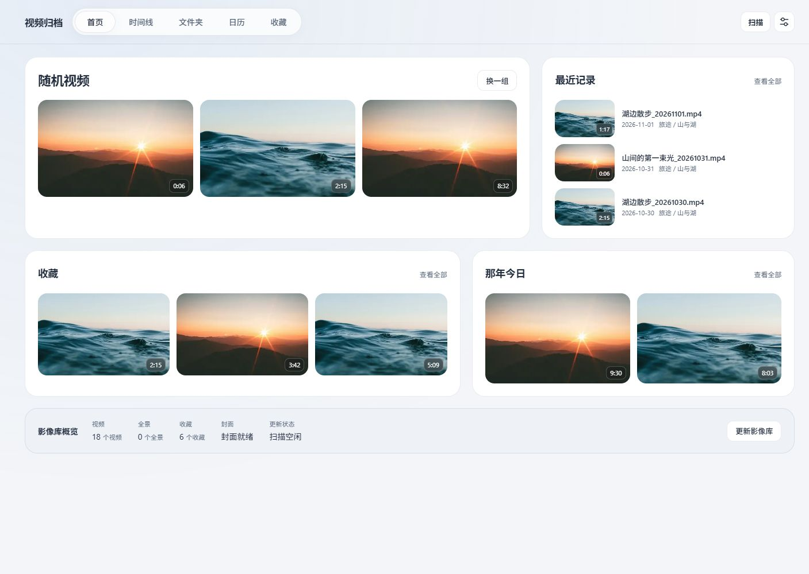
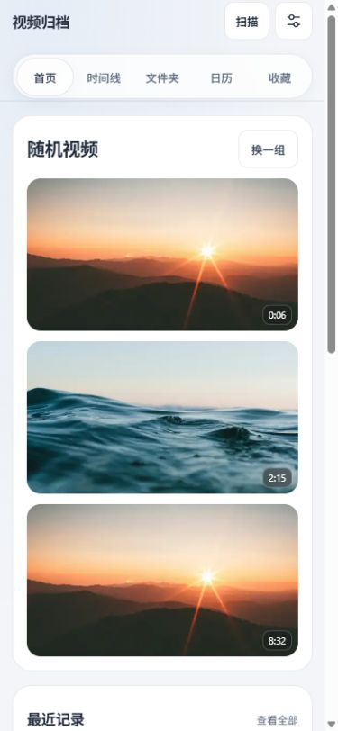

# 材质、圆角、工具栏与首页布局实施验收

final result: passed

本轮已完成用户指定的前两步：统一材质、圆角和工具栏，再调整首页模块布局。此结论针对已覆盖视口中的视觉与相关交互；完整可访问性、真实设备和媒体解码验收仍有下述未验证项。改动保留在本地，未打包或部署。

追加调整：按后续反馈，竖屏「随机视频」模块完整展开三张，移除上一张/下一张和计数导航，保留「换一组」。[最新竖屏效果](home-mobile-expanded.jpg)、[最新完整页面](home-mobile-expanded-full.jpg)；390×844 的首次加载和换组后、320×568 下均确认三张有可见尺寸，没有文档横向溢出。测量见 [random-expanded-measurements.json](random-expanded-measurements.json)。JS 语法及 diff 检查通过；独立只读复核未发现实质问题，一条/两条数据仅静态检查，未新增大套测试。

## 视觉依据与实施内容

依据 [已选方案](../gui-direction-2026-11-01.md) 与其中引用的 RC-UI-Style 新版规范，继续使用现有 Jinja/CSS/脚本，没有增加前端依赖或另一套导航、轮播和动画运行时。

- 普通输入和操作使用稳定浅底；轻磨砂集中在导航、保存栏和少量浮层。修正普通按钮被高优先级玻璃规则重新加模糊的问题。
- 圆角以控件 11px、卡片 16px、面板 22px 分层；保留五项导航胶囊和圆形播放按钮等已有用途。
- 工具栏控件统一为桌面 36px、手机 44px，窄窗口自然分行。滑块输入的实际高度也跟随控件 token。
- 首页桌面为随机三段主区、最近记录紧凑侧栏、收藏/那年今日下方分组及概览；手机按相同 DOM 顺序纵向排列，随机三张在同一个模块内全部展开。
- 首页保留一个静态柔光背景；视频库与设置使用稳定底色，移除持续漂移及永久 will-change。真实图片不加主题滤色。
- 更新样式资源版本及预载地址；近期记录新增独立缩略图容器，目录、时长及播放器事件继续使用原业务数据。

## 桌面与手机实际截图

以下是本轮浏览器渲染结果，使用独立示例数据库。18 条记录和文件名为演示数据，封面照片来自公开素材，不是用户视频库。源照片仅在本地测试目录使用，产品代码没有外部图片依赖。

| 页面 | 桌面 | 手机 |
| --- | --- | --- |
| 首页 | [桌面首页](home-desktop.jpg) | [手机首屏](home-mobile-expanded.jpg)、[手机完整页面](home-mobile-expanded-full.jpg) |
| 视频库 | [桌面时间线](library-desktop.jpg)、[筛选浮层](library-filter-desktop.jpg) | [手机时间线](library-mobile.jpg) |
| 设置 | [桌面设置](settings-desktop.jpg) | [手机设置](settings-mobile.jpg) |
| 边界状态 | [最窄播放器左栏](home-player-minimum-pane.jpg)、[空库桌面](home-empty-desktop.jpg) | [空库手机](home-empty-mobile.jpg)、[换组失败](home-shuffle-error-mobile.jpg) |

## 对照与图像规格

视觉源为已批准的文字方案及当前项目原界面；这是有意调整层级的改进，不作逐像素复刻。以下并列图保留前一步 GUI 实施时的状态（手机当时仍为逐张切换）；当前竖屏全展开效果见上方最新截图。前后首页均使用同一示例库和随机 IDs `2,3,16`，浅色、正常态、播放器关闭。

| 对照 | 浏览器 CSS 视口 | 工具输出的原始 JPEG | 归一方式 |
| --- | --- | --- | --- |
| 桌面 | 前后均为 1440×1000 | 原界面 1393×990；实施后 1407×1000 | 原图约 1% 同比放大至实施图尺寸，保持原始截图，便于整体比较 |
| 手机 | 前后均为 390×844 | 前后均为 375×812 | 不缩放，两图并列 |

截图工具实际输出 JPEG，文件按实际格式命名；不将输出像素数声称为浏览器视口或原生高分辨率。完整手机截图为 375×1427。并列图不能用于逐像素尺寸验收，控件尺寸另由 DOM 测量。

- [桌面前后并列](home-desktop-comparison.jpg)、[手机前后并列](home-mobile-comparison.jpg)：左为原界面，右为实施后；已打开同一组合图检查整体主次、留白、颜色和媒体。
- [页头局部并列](header-comparison.jpg)：用于查看字体、导航材质与控件形状；输入/卡片/面板圆角另核对计算样式与页面截图。

## 五项视觉检查

| 项目 | 观察结论 |
| --- | --- |
| 字体与排版 | 沿用系统字体；主标题、分组、近期记录文件名和元信息有层级，长文件名截断并保留完整 title |
| 间距与布局 | 桌面主区/侧栏对齐，手机纵向排列；工具栏换行、设置局部横向导航与页面滚动分开 |
| 配色与材质 | 正文落在稳定底色上；输入 11px、卡片 16px、面板 22px，普通控件不重复模糊；保存按钮蓝底白字 |
| 图像与图标 | 图片计算样式为 filter:none；保留已有图标，时长、收藏及 HDR 标签继续使用既有独立位置 |
| 文案与状态 | 没有加入宣传文案或演示业务状态；空库保留设置入口，换组失败保留旧内容并提示重试 |

## 定向运行证据

[measurements.json](measurements.json) 记录实际 DOM 测量；[console-records.json](console-records.json) 是主预览标签页本轮 warn/error 记录，结果为空。

| 检查 | 结果 |
| --- | --- |
| 桌面 1440×1000 / 手机 390×844 | 首页、视频库、设置未出现文档横向溢出 |
| 超宽首页 3440×1440 | 按可用宽度展开，没有文档横向溢出 |
| 最窄首页播放器左栏，1024×700 | 左栏约 300.16px，clientWidth/scrollWidth 均 285px；近期缩略图 88px、文字约 125px；关闭播放器正常 |
| 手机 320×568 | 首页无横向溢出，近期文字区域仍约 127px |
| 控件与材质 | 日期、搜索、筛选、滑块和时间轴开关桌面 36px / 手机 44px；普通控件 backdrop-filter:none；设置保存按钮手机 44px |
| 导航与菜单 | 首页/视频库/设置往返；筛选展开、Escape 关闭后焦点回到触发器，焦点轮廓可见 |
| 前一步手机随机逐张切换（已替换） | 当时验证 1/3 → 2/3；后续已改为三张完整展开 |
| 随机换组成功 | 原组 2,3,16 → 新组 7,9,15，busy 清除、按钮文案恢复、没有错误反馈 |
| 随机换组失败 | 隔离接口返回 503，6,9,14 三张旧内容保留，提示“加载失败，请重试。”，busy 清除、按钮恢复可用 |
| 空库 | 桌面/手机均保留设置目录入口，随机按钮禁用，分组及概览没有被撑破 |

只运行三项与模板/共享样式加载直接相关的既有测试：`test_home_routes_and_legacy_library_links`、`test_home_and_library_share_navigation_without_duplicate_library_actions`、`test_streaming_loader_precedes_page_data`，**3 passed，1.62s**。日志在本地忽略目录 `tmp/gui-style-tests-20261101.log`。16 条警告为已有 FastAPI on_event 弃用提示；未扩大全套测试，未做哈希校验。`git diff --check` 通过。

## 修复与复验记录

| 首轮问题 | 修正 | 复验 |
| --- | --- | --- |
| 近期记录用最后一个 span 隐藏尺寸，关闭尺寸时可能误隐藏目录 | 为尺寸添加 home-video-size，只隐藏这一项 | 静态核对条件及当前近期记录截图 |
| 近期缩略列使用视口单位，窄播放器栏可能挤压标题 | 播放器状态固定 88px 缩略列 | 300px 左栏实际测量和截图 |
| 普通控件的 none 被重复 glass-surface 选择器覆盖 | 只提高控件滤镜回退的选择器优先级，保留语义填充 | 桌面/手机六类控件实际 backdrop-filter 均为 none |
| 保存按钮在通用实色降级中可能白字白底 | 为保存按钮设置明确实色蓝背景，优先于通用回退 | 静态级联核对；普通模式截图/计算颜色，系统降级模式未实测 |
| 横向触控导航没有跟随 44px token | 导航最小高度取 38px 与控件 token 的较大值 | 静态核对 coarse 分支；手机实际 44px，真实平板未实测 |
| 减少动效时图片仍会瞬间 hover 缩放 | 在现有 reduced-motion 分支取消两处 transform | 静态核对；系统偏好切换未实测 |

## 独立复核与边界

由同一独立子代理完成首轮只读审查及修复后的复核，没有让它操作浏览器或重复运行测试；提供需求、方案、原始截图及日志，未提供作者评分。最后一轮未发现剩余阻断项。

| 合并模块 | 独立静态评分 | 独立运行评分 |
| --- | --- | --- |
| 布局、响应式与窄左栏 | 5/5 | 4/5，暂定 |
| 材质、圆角、排版与配色 | 5/5 | 4/5，暂定 |
| 按钮、状态与可访问性降级 | 5/5 | 4/5，暂定 |

运行证据覆盖八组：桌面、手机、超宽屏、最窄左栏、最终材质、36/44px 控件、媒体原色、空库/换组失败恢复。仍缺六组：键盘完整操作及快速中断、系统减少动效、透明度/高对比及不支持 blur 回退、200% 缩放、真实触控/辅助技术、实际绘制性能。运行覆盖为 **8/14**，三个模块都属部分验证，不计算运行总分；不能据此声称全界面可访问性验收完成。

本轮仅验证播放器的打开、分栏、控件布局和关闭。当前内置浏览器未成功解码示例 MP4，保留海报与控制栏；不把截图或元数据加载当作播放成功，也未验证真实用户视频或 HDR 显示。未做发布、镜像构建和真实服务部署。

## 演示素材与复现

预览使用本地忽略目录中的 `tmp/gui-style-preview.py`，主预览端口 18743；原界面快照用于同数据对照。空/失败状态由 `tmp/gui-style-states.py` 隔离构造，未读取或清理真实媒体库。演示源照片为 [Unsplash 海面照片](https://images.unsplash.com/photo-1518837695005-2083093ee35b) 与 [Unsplash 日落照片](https://images.unsplash.com/photo-1500534623283-312aade485b7)，没有把素材添加到产品静态资源。
