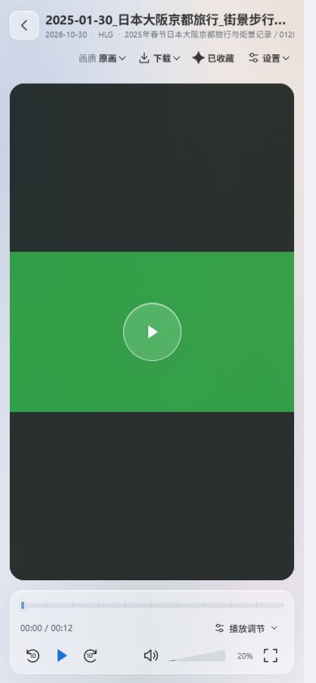

# 播放标题栏分辨率检查

2026-10-30，独立测试库和生成的视频样例，使用浏览器视口验证。

| 视口 | 独立播放页标题栏 | 页面横向溢出 / 下载菜单越界 |
| --- | --- | --- |
| 3440×1440、1920×1080、1366×768、1024×768 | 约 40px | 无 / 无 |
| 720×720 方屏 | 约 40px | 无 / 无 |
| 390×844、320×568 手机竖屏 | 约 78px，沿用两行布局 | 无 / 无 |
| 844×390 手机横屏 | 约 40px | 无 / 无 |

3440×1440、1920×1080、1366×768 的分栏播放标题栏均为 52px，下载菜单均在视口内。窄分栏按钮压缩沿用上一轮验收。

长文件名和长目录暴露出元信息被压缩的问题：目录及 HLG 标签几乎消失。修复后 HDR 标准排在日期之后，整行支持横向滚动，不增加标题栏高度。320px 视口确认 HLG 有完整宽度，方向键滚动信息行 80px，未触发视频快进反馈。

截图中的色带和 HDR 标签为隔离界面样例，不代表真实 HDR 显示或实际手机设备验收。

