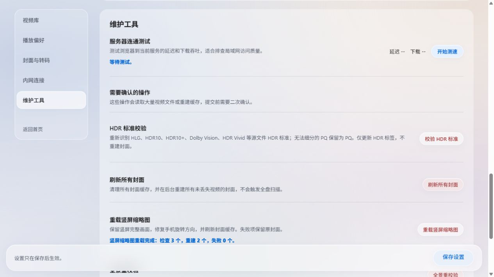
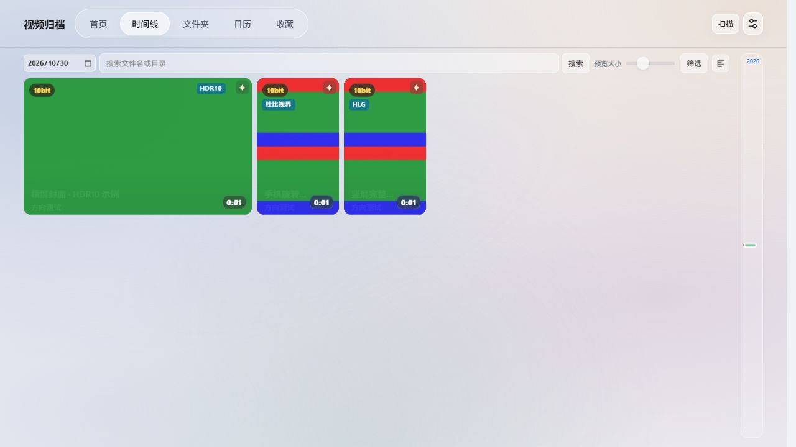
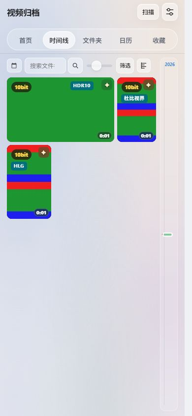

# 竖屏封面与 HDR 标签验收

2026-10-30，独立临时数据库与生成的测试视频；没有操作真实视频库。

- 真实 FFmpeg 样例：96×160 竖屏，以及编码尺寸 160×96、显示旋转 90° 的手机样例。生成 288×480 四宫格，四个子图的红色顶部和蓝色底部均保留。
- 「设置 → 维护工具 → 重载竖屏缩略图」实测完成：检查 3 个，重建 2 个，失败 0 个；横屏未重建。状态自动更新，按钮重新可用。
- 覆盖首页、时间线、收藏、文件夹、详情和播放器的缩略图修订号；未带当前修订号的请求不使用长期不可变缓存。失败项保留原记录和封面。
- 标签直接显示 HLG、HDR10、HDR10+、杜比视界等已识别的源标准；窄竖屏卡片中的标签下移，避开 10bit 与收藏。未更改 HDR 识别规则、转码或缩略图色彩处理。
- 浏览器检查：390×844 手机竖屏、640×640 方屏、3440×1440 超宽屏无页面横向溢出，样例标签无截断；首页竖屏封面使用 contain。截图中的 HDR 元数据为界面测试数据，不代表生成的色带视频是 HDR。
- 定向测试：真实抽帧与旋转、竖屏筛选及失败保留、后台互斥与状态、页面标签与缓存、现有横屏生成及 HLG 时间线用例。未进行全量测试或真实 NAS 验收。

