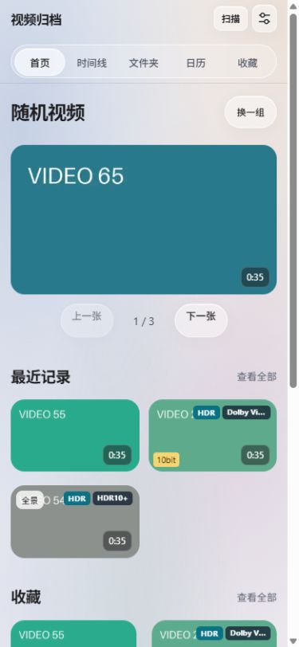
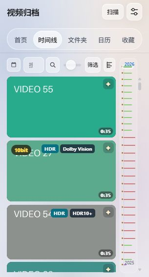
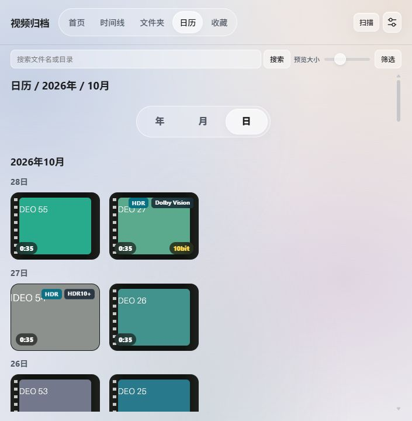
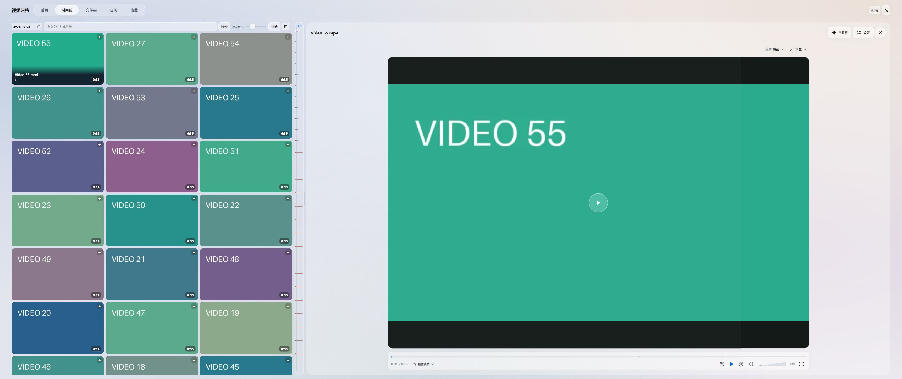
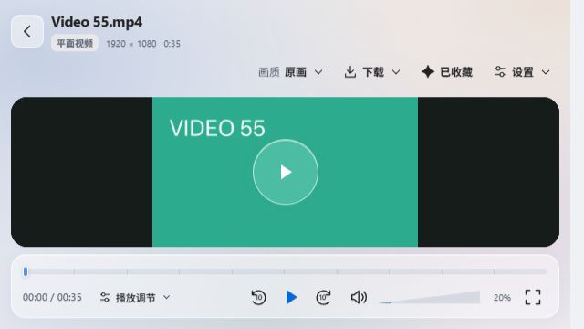
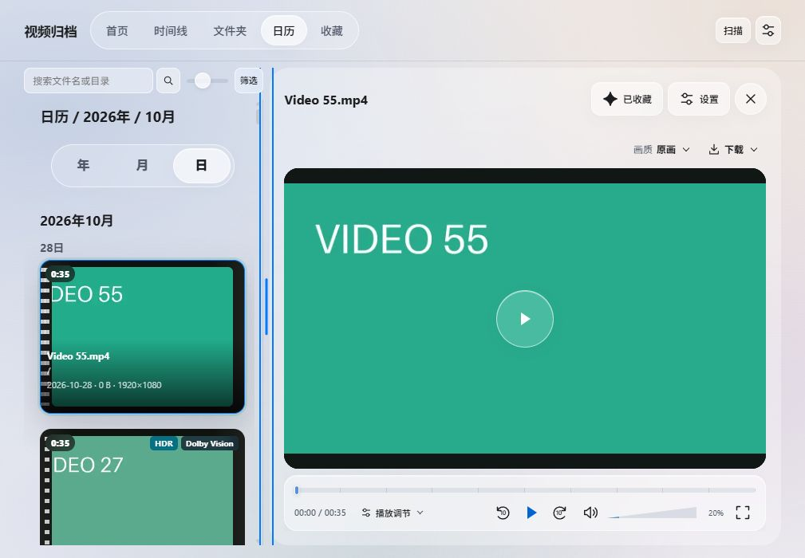
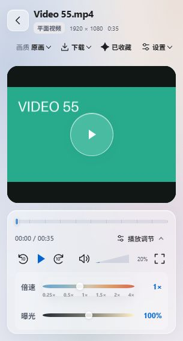
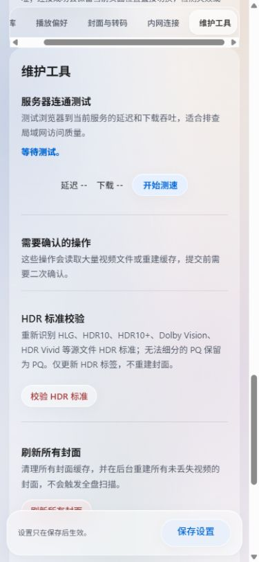

# 响应式布局检查（2026-10-30）

结论：本轮覆盖的尺寸和流程中，修复后没有发现阻碍使用的横向溢出、播放器分栏挤压或标签遮挡。不能据此保证任意分辨率、所有浏览器与真机都完美。

检查对象是当前工作区代码，使用本地独立示例数据库、72 条视频记录和绘制的封面，包含长中文文件名、长文件夹名、横竖视频、HDR10+、Dolby Vision 和 10bit 标签。没有扫描或修改实际视频库。截图中的播放器使用不存在的示例媒体，黑色画面仅用于验证布局，不代表实际播放成功。

## 覆盖范围

以下尺寸均为浏览器 CSS 视口像素，不是屏幕物理像素。

| 类型 | 尺寸 |
| --- | --- |
| 手机竖屏 | 320×568、390×844 |
| 方屏 | 480×480、720×720 |
| 手机横屏 | 844×390，另针对 640×360 复查播放器 |
| 小桌面 | 1024×700 |
| 竖向显示器 | 1080×1920 |
| 常规桌面 | 1920×1080 |
| 超宽屏 | 3440×1440、4096×1152 |

时间线、文件夹、收藏、日历聚合视图分别检查上述十种矩阵尺寸，共 40 个组合；日历日视图额外检查 320、480、1024 像素宽度。修复后这些组合均未检测到文档/列表横向溢出、卡片超出列表边界或视频库外层多余的纵向滚动。另检查首页、筛选弹层、设置及播放控制，具体覆盖见下文。

## 1. 首页：覆盖范围内通过

检查 320×568、390×844、480×480、720×720。导航换行，随机视频和各分区卡片可用；长 HDR 标准名称在窄卡片中省略，避免遮住视频类型标签。首页有意保留正常纵向滚动。

## 2. 视频库与筛选：覆盖范围内通过

超宽屏使用可用宽度，列表按自身容器宽度排布。窄屏及内嵌播放器左栏不会被固定卡片最小宽度撑开。长文件夹名、不同视频方向和标签组合纳入示例数据。

本轮发现并修复日历/收藏小卡片的 HDR 标签与时长重叠：时长移至左下角，HDR 标签限制可用宽度，长标准名称省略。视频库采用纵向弹性布局，由页头实际高度决定列表高度，消除外层多余滚动。

390×844 与 480×480 的筛选弹层可访问；方屏高度不足时弹层内部滚动，底部操作仍可到达。

| 手机时间线（320×568） | 方屏日历（720×720） |
| --- | --- |
|  |  |

## 3. 打开视频与调节分栏：布局通过，实际媒体播放未验收

原先仅凭宽高比判断是否分栏，640×360 手机横屏也会打开内嵌播放器，使左侧搜索输入框缩到约 22px，播放控制超出可视区域。现在首页和视频库共用判断：视口至少 1000×600，且宽高比大于 4:3 才使用内嵌播放器；其余进入完整播放页。

分隔条保证左侧列表至少 300px、右侧播放器至少 420px；1024×700 下通过键盘调整至极限后，实测左栏仍约 300px。窗口缩小时重新限制分栏，转为 720×720 方屏时退出内嵌布局。

完整播放页检查 320×568、390×844、480×480、720×720、844×390、1080×1920；320 像素宽时展开倍速及曝光控制仍可见。3440×1440 的内嵌播放器及左栏缩略图布局已截图检查。

| 手机横屏完整播放页（640×360） | 最小左栏（1024×700） |
| --- | --- |
|  |  |

修复前的 [640×360 分栏截图](inline-640-before.jpg) 保留用于对照。

## 4. 设置与维护工具：覆盖范围内通过

检查 320×568、390×844、480×480、720×720、820×1180、1080×1920、3440×1440，未发现输入框超出页面。HDR 标准校验按钮可见。

本轮修复了玻璃装饰样式覆盖设置导航 `sticky` 定位的问题。手机滚动至维护工具后，分类导航留在顶部，维护区标题和操作可访问。

## 验证记录与限制

- 浏览器使用桌面 Chromium 内核的内置浏览器。截图已逐张检查，尺寸切换中的加载帧和错误裁剪帧未作为结果保留。
- [measurements.json](measurements.json) 的 `matrix` 是最终列表测量；`other` 包含本轮探索过程数据，可能含修复前状态，不能将所有条目都视为最终结果。
- 两个相关页面回归测试通过：流式加载顺序、首页/视频库共用导航。`app.js`、`inline-player.js` 语法检查和 `git diff --check` 通过。未运行完整测试套件。
- 当前浏览器视口宽度上限为 4096；请求 5120 时实际受限，因此不能声称已经验证 5120×1440。
- 尚未验证 iOS Safari、真实 Android 浏览器、软键盘弹出、安全区、浏览器地址栏动态变化、系统字体放大和不同设备缩放比例。分栏键盘调节已检查，未进行完整屏幕阅读器或触控可达性验收。
- 本轮没有验证真实视频解码、HDR 显示或色彩效果。它们与布局验收分开。
- 修改保留在本地工作区，未打包、部署或发布。
