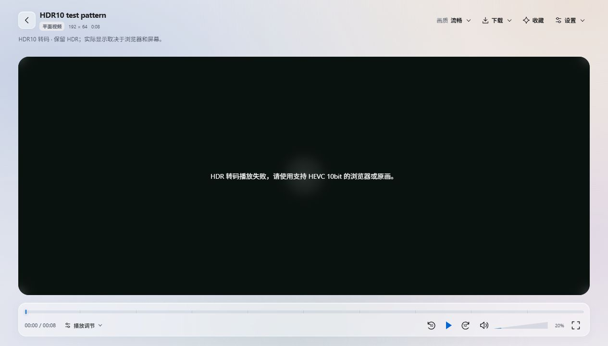

# HDR 管线检查与转码调整（2026-10-30）

结论：此前的 HDR 转码不完整。现在服务端的 PQ/HDR10、HLG 转码可保留 10bit HDR，但不能声称从所有源格式到所有浏览器、显示器的整条管线已完美。

本次按用户要求保留现有缩略图生成方式，没有新增缩略图 HDR 输出或 HDR→SDR 色调映射。

## 已确认的问题

1. 原有 HLS 和转码下载固定使用 H.264/yuv420p。对 10bit HDR10 测试片实际转码后，输出成为 8bit，仍携带 BT.2020/PQ 标签。三个灰阶样本的亮度编码值几乎原样降位深，不能当作可靠的 HDR 保留或 SDR 转换。[修复前测量](hdr-audit-before-2026-10-30.json)。
2. 可选帧元数据探测超时时，标准校验会把已知 HDR10 覆盖为 PQ，并报告成功。主探测超时则可能中断整批任务。
3. 全景播放器使用普通 WebGL RGBA/UNSIGNED_BYTE 纹理，没有实现可保证 HDR 输出的显示管线。源文件或串流带 HDR 不等于全景画布已输出 HDR。

## 当前行为

| 输入/操作 | 输出与处理 |
| --- | --- |
| HDR10 / PQ | HEVC Main10；保留传递函数、色域、矩阵、范围及已探测到的静态元数据 |
| HLG | HEVC Main10 / HLG，保留源色彩参数 |
| HDR10+ / HDR Vivid | 保留 PQ/HLG 基础 HDR；动态元数据不保留，播放器显示说明 |
| Dolby Vision 8.1 / 8.4 | 仅在兼容性标识与实际传递函数一致时输出基础 HDR10/PQ 或 HLG；不保留 Dolby Vision 动态元数据 |
| 其他 Dolby Vision、缺失/不支持的 HDR 色彩参数 | 明确拒绝转码并建议使用原画，防止错误解释像素 |
| 原画播放/下载 | 继续读取源文件，不改写源文件 |
| SDR | 继续使用现有 H.264 编码器设置 |
| 缩略图 | 维持原来的 WebP/全景封面生成方式 |

HDR 编码固定使用 CPU libx265，选择 ultrafast 或 veryfast 预设。现有 QSV/VAAPI H.264 选项继续用于 SDR。4K/8K HDR 的实时转码速度需要在部署设备上验证。

HLS 改用 fMP4，提供初始化段和 m4s 分片；主播放列表使用 FFmpeg 生成的实际 HEVC codec/level，加上 PQ 或 HLG 的 VIDEO-RANGE。媒体列表独立路由并禁用缓存，避免主列表递归及直播式更新被缓存。旧 H.264 缓存通过新版本键隔离，不会作为新的 HDR 输出复用。

缩放显式保留源数值范围与矩阵。重编码前移除帧附加数据，再由 x265 写回经过解析的静态 HDR 元数据，避免把旧动态元数据直接附着到新编码的画面上。动态标准完整保留仍需使用原画。

播放器检查 HEVC 支持并显示实际转码格式；格式检查失败或播放失败时停止重试、显示错误，不提供静默 SDR 回退。默认曝光 100% 不再施加无意义的 CSS brightness 滤镜。

标准校验现在将不完整的帧探测计为失败并保留旧标签；主 FFprobe 超时及解析错误统一为单文件错误。基础扫描仍允许保留可用的时长、尺寸等信息。

## 验证

- 本地 FFmpeg 真实生成并转码三个小样本：HDR10 limited range、HLG limited range、HDR10 full range。实际解码转码下载文件及 HLS 初始化段+分片组合，确认 HEVC、10bit、色彩参数和源范围；HDR10 的 Mastering Display、MaxCLL、MaxFALL 保留。
- 实际 HTTP 路径验证：playback-info 返回 HDR10；主列表包含 VIDEO-RANGE=PQ；媒体列表包含 init.mp4 / m4s；初始化段及分片返回 video/mp4，媒体列表使用 no-cache。
- HDR 探测、转码命令、标准校验失败保留、缓存/HLS 路由、SDR 原有路径的针对性回归通过。缩略图平面和全景的既有命令测试通过。未运行完整套件或大文件压力测试。
- 当前内置测试浏览器对该 HEVC 样本实播失败，失败提示可见。该结果不能作为 HDR 显示验收，也不能证明用户的实际浏览器会失败。

## 尚未验收

- 真实 HDR 显示器上的峰值亮度、颜色、系统合成和浏览器 HDR 输出。
- 全景画布 HDR 显示；目前仍需单独实现，串流保留 HDR 不代表画布显示保留。
- 真实 HDR10+、HDR Vivid、Dolby Vision 文件的端到端测试；目前兼容性规则有单元测试，真实编码样本验证仅覆盖 HDR10/PQ 和 HLG。
- 部署容器的 FFmpeg/libx265 构建、设备性能及浏览器组合；本次未构建、部署或发布。

## 参考依据

- [FFmpeg HLS/fMP4 文档](https://ffmpeg.org/ffmpeg-formats.html#hls-2)：分片和初始化段的封装方式。
- [Apple HLS authoring specification](https://developer.apple.com/streaming/hls-authoring-specification-for-apple-devices.html)：HEVC、HDR 与 VIDEO-RANGE 信令。
- [x265 编码参数](https://x265.readthedocs.io/en/stable/cli.html)：色彩参数、Mastering Display 和 MaxCLL。
- [Dolby Vision profiles](https://ott.dolby.com/OnDelKits/Dolby_Vision_Online_Delivery_Kit/v1/Documentation/Specs/Visio_Profiles/help_files/topics/c_dovi_profiles.html)：HDR10/HLG 基础层兼容性。
